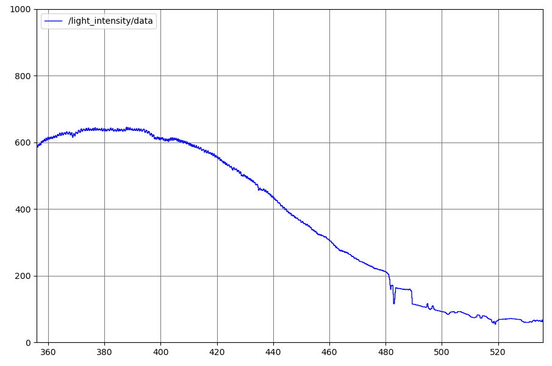
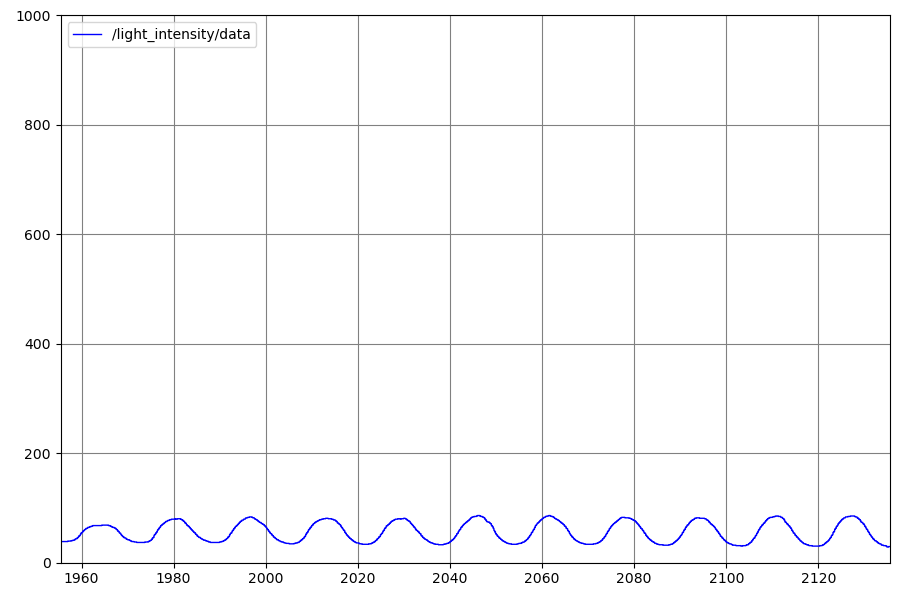

# Zbiór badań przeprowadzonych na robocie MTracker

## 1. Badanie intensywności światła podczas przejazdu przez pomieszczenie

Pierwszy etap badań miał na celu poznanie sposobu działania czujnika intensywności światła oraz analizę zmian rejestrowanych wartości w zależności od położenia robota w otoczeniu.

**Rysunek 1.** Zmiany intensywności światła zarejestrowane podczas przejazdu robota przez salę 426.

## 2. Badanie intensywności światła podczas ruchu po trajektorii kołowej

W kolejnym etapie robot poruszał się po trajektorii kołowej, a źródło światła zostało umieszczone w centrum wyznaczonego okręgu. Celem badania było zaobserwowanie zmian intensywności światła rejestrowanych przez czujnik w trakcie ruchu robota wokół źródła światła.

**Rysunek 2.** Zmiany intensywności światła zarejestrowane podczas ruchu robota po trajektorii kołowej ze źródłem światła umieszczonym w jej centrum.
